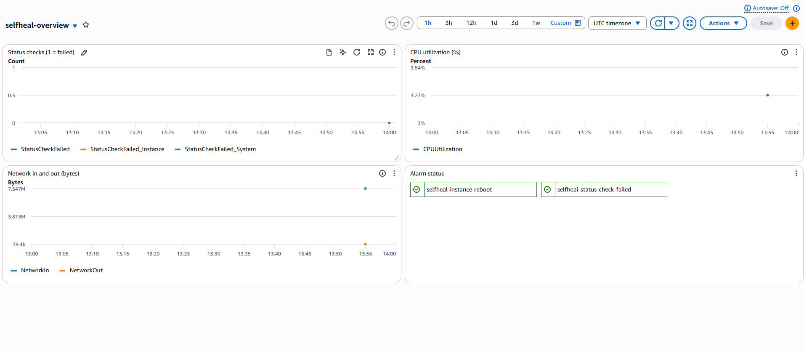

# AWS VPC + Self-Healing Web Server

A small AWS environment built entirely as code. Terraform builds a VPC with a public web server, a GitHub Actions pipeline plans every change and deploys it on merge, and a monitoring setup detects failures and repairs some of them automatically.

- **Network and server:** VPC, public and private subnets, internet gateway, route table, security group, one EC2 web server (Apache)
- **Delivery:** GitHub Actions runs `terraform plan` on pull requests and `terraform apply` on merge. It logs in to AWS with OIDC, so **no AWS keys are stored in GitHub**
- **Monitoring and repair:** CloudWatch alarms, an SNS email alert, a dashboard, a Python health check that restarts Apache through SSM, and an alarm that reboots the server
- Region `us-east-1`. Built to be cheap: no NAT gateway or load balancer, and everything is destroyed after each session



## Architecture

```
Internet
   |
Internet Gateway
   |
Route table (0.0.0.0/0 -> internet gateway)
   |
VPC 10.0.0.0/16
 |-- Public subnet 10.0.1.0/24
 |     `-- EC2 web server (Amazon Linux 2023, t3.micro, Apache)
 |           security group: ports 22 and 80 from my own IP (/32) only
 `-- Private subnet 10.0.2.0/24 (empty on purpose: shows public/private separation)

CloudWatch alarms -> SNS topic -> email
Health check script (Python/boto3) -> SSM -> restart Apache -> SNS email
GitHub Actions -> OIDC -> IAM role -> Terraform -> AWS
```

### How a request reaches the server
1. My browser asks for the server's public IP on port 80.
2. The request enters the VPC through the **internet gateway**.
3. The **route table** of the public subnet sends internet traffic through that gateway.
4. The **security group** checks the source: only my own IP is allowed on ports 22 and 80. Anything else is dropped.
5. Apache answers, and the security group (which is stateful) lets the reply go back out the same way.

The private subnet has no route to the internet. It is empty on purpose.

## What is in the repo

| File | Purpose |
|---|---|
| `main.tf`, `variables.tf`, `providers.tf`, `outputs.tf` | The 15 resources, written as Terraform |
| `backend.tf` | State in an S3 bucket (versioned, encrypted, public access blocked, native locking) |
| `.github/workflows/terraform.yml` | `plan` on pull request, `apply` on merge, OIDC login |
| `healthcheck.py` | Checks the web page every 10 seconds, restarts Apache through SSM if it is down, emails the result |
| `reboot_test.py` | Forces the reboot alarm and measures how long the page is down |
| `docs/dashboard.png` | Screenshot of the CloudWatch dashboard |

**Created once by hand with the AWS CLI (not in Terraform):** the S3 state bucket, the GitHub OIDC provider, the IAM role for the pipeline, and the SNS topic with its confirmed email subscription. These must outlive every destroy.

## How to run it

1. Create a `terraform.tfvars` (gitignored) with `my_ip` (your IPv4 with `/32`) and `alert_topic_arn`.
2. Put your SSH public key at `~/.ssh/tf-key.pub`.
3. `terraform init`, then `terraform apply`. Destroy with `terraform destroy`.
4. Through the pipeline: open a pull request to see the plan, merge to deploy. The repo needs the secret `MY_IP` and the variables `TF_PUBLIC_KEY` and `ALERT_TOPIC_ARN`.

Check your IP before every build (`curl -4 https://checkip.amazonaws.com`). If it changes, update both `terraform.tfvars` and the `MY_IP` secret, or the security group will block you.

## Results

All numbers are from my own runs.

| What | Result | How it was measured |
|---|---|---|
| Build from empty, early version (9 resources) | 42s | `Measure-Command terraform apply`, laptop |
| Build from empty, current version (15 resources) | 69.5s | same |
| Pipeline `apply` on merge | 42s for 15 resources (52s for 14, 1m 5s for 13) | GitHub Actions job time |
| Pipeline `plan` on pull request | 20 to 28s | GitHub Actions job time |
| Apache stopped: time to repair once detected | 2.9s to 4.4s (8 runs) | timer inside the script |
| Apache stopped: break to page back, 10s check interval | 11s to 18s, average 14s (3 runs) | clock times |
| Reboot alarm (forced): page down | 17.4s to 22.2s, average 19.4s (4 runs) | `reboot_test.py` |

- Every destroy ended clean, and I checked AWS was empty afterwards.
- No AWS keys are stored in GitHub. The pipeline role is limited to EC2/VPC, the state bucket and resources named `selfheal-*`. IAM actions are limited by name and to one attachable policy.
- The recovery numbers were measured with an earlier version of `healthcheck.py` that had the instance ID and IP typed in. The current version finds the server by its Name tag.
- The reboot test **forced the alarm state**. It was not a real crash, and it skips the detection time: a real failure needs two one-minute readings, so about 2 minutes before the alarm acts.

## Runbook

Each alarm's description points here. Alarms carry the tags `Owner`, `Service`, `Severity` and `Runbook`.

**`selfheal-status-check-failed` (SEV2, email only)**
- *Means:* AWS says the server failed its instance or system health check.
- *Check:* `aws ec2 describe-instance-status --instance-ids <id>`, then try the page.
- *Fix:* if the instance check failed, the reboot alarm acts on its own. For a system failure, stop and start the instance, or rebuild with `terraform apply`.

**`selfheal-instance-reboot` (SEV2, reboots the server, then emails)**
- *Means:* the instance check failed for 2 minutes in a row and AWS rebooted the server.
- *Check:* `uptime -s` through SSM (the boot time changed), and `aws cloudwatch describe-alarm-history --alarm-name selfheal-instance-reboot`.
- *Fix:* if it keeps firing after reboots, the server is broken. Rebuild it with `terraform destroy`, then `apply`.

**"Selfheal: recovery FAILED" email (from the script)**
- *Means:* the page was down and stayed down 120 seconds after Apache was restarted.
- *Check first:* does my current IP match the security group? (`curl -4 https://checkip.amazonaws.com`). Then check Apache from inside the server: `systemctl is-active httpd` through SSM.

## Known limits

- The health check runs on my laptop, so it depends on my home IP. In production the checker would run inside AWS.
- It cannot tell "the server is down" from "I can't reach the server". That caused two false alarms: once while a new server was still booting, and once when my IP had changed and the security group blocked me. Apache was healthy both times.
- The reboot alarm was tested by forcing it, not by a real crash.
- Samples are small (3 to 8 runs each).
- CloudWatch only: no logs and no traces.
- The pipeline uses one role for both `plan` and `apply`, and `ec2:*` is broader than the exact actions Terraform needs.
- The one-time resources (state bucket, OIDC provider, pipeline role, SNS topic) are created by hand.

## What I would do next

- Run the checker in AWS (Lambda on a schedule) and add a grace period after launch
- Check from inside the server (SSM) before restarting anything, and alert only after several failures in a row
- Collect Apache logs with the CloudWatch agent and alarm on error rates
- A separate read-only role for `plan`, branch protection, and applying a saved plan
- Put the one-time resources in Terraform too

## Problems I hit and fixed

- **Pipeline could not log in to AWS:** the OIDC `sub` claim included numeric account and repo IDs, so my trust rule never matched. I printed the real claims and fixed the rule.
- **SSM did not see the server** right after I attached its role. Restarting the SSM agent fixed it.
- **Health check reported a failure while Apache was fine:** my public IP had changed, and the security group correctly blocked my laptop.
- **Email alerts stopped:** the SNS subscription had been deleted after confirmation. I re-subscribed, and now only read alert emails and never click links in them.
