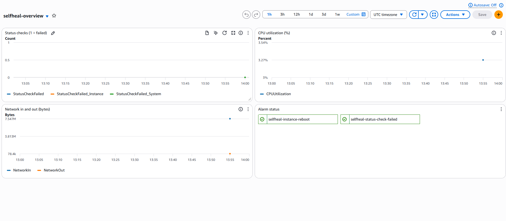

# AWS VPC + Self-Healing Web Server

A small website on AWS, built entirely as code. If the site stops working, it fixes itself and emails me.

**What's in it**
- **A private network on AWS**, with a public part (where the web server sits) and a private part (kept empty on purpose)
- **A web server** running Apache, serving one page
- **Terraform code** that builds all of it the same way every time, and removes it again with one command
- **An automatic pipeline (GitHub Actions)** that previews each change and deploys it when I merge. It logs in to AWS with a short-lived pass (OIDC), so **no AWS keys are stored in GitHub**
- **Monitoring:** CloudWatch alarms, a dashboard, and email alerts
- **A Python script** that keeps checking the website and restarts Apache if it is down

## Architecture

## How a visitor reaches the server

1. A visitor opens the server's address in a browser.
2. The request comes into my network through the **internet gateway**, the front door.
3. The **route table**, the signposts, sends it to the public part of the network.
4. The **security group**, a guard with a guest list, checks who is asking. Only my own address is allowed, so anyone else is blocked.
5. Apache answers with the page, and the reply goes back the same way.

## The pieces in plain words

| Piece | What it does |
|---|---|
| **VPC** | My own private network inside AWS |
| **Public subnet** | The part of the network that faces the internet. The web server sits here |
| **Private subnet** | A part with no route to the internet. Empty on purpose, to show the split |
| **Internet gateway** | The front door between the network and the internet |
| **Route table** | The signposts that send traffic to the front door |
| **Security group** | The guard: only my address may reach the server |
| **EC2 server** | The computer that runs the website (Apache) |
| **Terraform** | Writes all of the above as code, so it is built the same way every time |
| **S3 bucket** | Safe storage for Terraform's record of what it built |
| **GitHub Actions + OIDC** | The robot that previews and deploys changes, logging in with a short-lived pass |
| **CloudWatch** | Watches the server's health, with alarms and a dashboard |
| **SNS** | Sends the email alerts |
| **SSM** | A remote control that lets the script restart Apache without logging in |
| **Python script** | Checks the website and repairs Apache |

## What happens when something breaks

| What breaks | What happens |
|---|---|
| **The website program (Apache) stops** | The Python script notices, restarts Apache through SSM, and emails me |
| **The server itself stops responding** | A CloudWatch alarm reboots it and emails me |

## What I tested

- The whole thing builds from nothing with one command (15 pieces), and every teardown left AWS clean
- I stopped Apache on purpose several times, and the script brought the site back each time
- I tested the reboot alarm by forcing it. I did not crash a real server
- No AWS keys are stored in GitHub

## How to run it

1. Create a `terraform.tfvars` file (kept out of Git) with `my_ip` (your public IPv4 address plus `/32`) and `alert_topic_arn`.
2. Put your SSH public key at `~/.ssh/tf-key.pub`.
3. Run `terraform init`, then `terraform apply`. Remove everything with `terraform destroy`.
4. Or use the pipeline: open a pull request to see the preview, then merge to deploy. It needs the GitHub secret `MY_IP` and the variables `TF_PUBLIC_KEY` and `ALERT_TOPIC_ARN`.

**Tip:** check your address before each build (`curl -4 https://checkip.amazonaws.com`). If it changed, update it in both places, or the security group will block you.

A few things were set up once by hand and stay in place between builds: the S3 bucket, the GitHub-to-AWS login setup (OIDC) and its role, and the email topic.

## Files in the repo

| File | What it is |
|---|---|
| `main.tf`, `variables.tf`, `providers.tf`, `outputs.tf` | The infrastructure, as Terraform code |
| `backend.tf` | Keeps Terraform's record in a private S3 bucket |
| `.github/workflows/terraform.yml` | The pipeline |
| `healthcheck.py` | The website check and repair script |
| `reboot_test.py` | A test script for the reboot alarm |
| `docs/` | The dashboard screenshot and the architecture diagram |

## Problems I hit and fixed

- **The pipeline could not log in to AWS.** GitHub's pass included extra ID numbers that my rule did not expect. I printed the real values, compared them, and fixed the rule.
- **SSM could not see the server** right after I gave it its role. Restarting the SSM agent fixed it.
- **The script said the site was down while Apache was fine.** My home address had changed, and the security group correctly blocked my laptop.
- **Email alerts stopped.** The email subscription had been removed after I confirmed it. I subscribed again, and now I only read alert emails and never click links in them.
